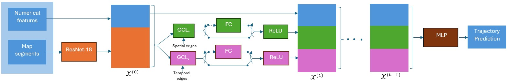

# A Comparative Study of Graph Neural Network Layer Selection for Interaction Modelling in Driving Trajectory Prediction

**George Daoud, Mohamed El-Darieby**

*IEEE Intelligent Vehicles Symposium (IV 2026) Workshops*

[](https://doi.org/10.48550/arXiv.2606.14956)
[](https://doi.org/10.1109/IVWorkshops71735.2026.11624111)

* arXiv: https://doi.org/10.48550/arXiv.2606.14956
* IEEE: https://doi.org/10.1109/IVWorkshops71735.2026.11624111

## Overview

GNN-based trajectory predictors use many different graph layers, and there is little guidance on which layers best capture **spatial interactions** between road agents and the **temporal dynamics** of each agent. This paper compares **19 graph convolution layer (GCL) types** as the spatial and temporal layers of a spatio-temporal GNN trajectory predictor. It tests 55 spatial/temporal combinations and identifies the strongest ones.

## Framework


*Figure 1: Overall architecture. Numerical agent features and a ResNet-18 map embedding form the initial node representation, which paired spatial (GCL<sub>s</sub>) and temporal (GCL<sub>t</sub>) graph convolution layers update over h iterations, with optional FC projections. An MLP head then outputs the predicted trajectory.*

- **Graph construction**
  - *Spatial edges* connect agents in the same frame that are within 30 m of each other.
  - *Temporal edges* connect consecutive observations of the same agent.
- **Node features**: agent dimensions, heading and type, combined with a 200-d map embedding from a ResNet-18 map encoder. The map is centred but not rotated.
- **Message passing**: paired spatial and temporal GCLs, with 100-d embeddings, 4 GCL layers and skip connections to reduce over-smoothing.
- **Output**: an MLP head predicts a single (unimodal) 25-step trajectory per agent.
- **Horizon**: 1 s of observation (5 frames at 5 Hz) to predict 5 s into the future.

## Dataset

The experiments use the [rounD](https://levelxdata.com/round-dataset/) dataset, drone recordings of German roundabouts. Only the third recording scenario is used, downsampled from 25 FPS to 5 FPS.

| Property | Value |
|---|---|
| Frames / nodes | 5.4K / 54.4K |
| Spatial / temporal edges | 203.9K / 53.7K |
| Valid (predictable) nodes | 34K (62.5%) |
| Split | 70% train / 20% val / 10% test |

## Layers Compared

| Category | Layers |
|---|---|
| Traditional convolutions | GCN (baseline), GraphSAGE, HoGraph |
| Single-head attention | AGNN, FA, GAT, LEConv |
| Multi-head attention | EGC, Graph Transformer, SuperGAT |
| Topology-based | SGC, S2GC, MixHop, TAGCN, MF (Molecular Fingerprints) |
| Recurrent | Gated GCN (GRU), Residual Gated GCN (ResGRU) |
| Specialized filters | ARMA, Chebyshev |

## Training

- Adam optimizer for 60 epochs with MSE loss.
- Learning rate starts at 1e-3 (1e-4 for EGC). It is divided by 10 after epoch 30 and again 20 epochs later.
- The checkpoint with the best validation ADE is kept.
- Hardware: one RTX 4090 GPU, about 10 hours per model.

## Results

### Top five spatial/temporal combinations

| Spatial GCL | Temporal GCL | ADE @3s | ADE @5s | FDE @3s | FDE @5s |
|---|---|---|---|---|---|
| **Chebyshev** | **Chebyshev** | **0.65** | **1.10** | **1.19** | **2.45** |
| MF | GCN | 0.67 | 1.15 | 1.25 | 2.54 |
| TAGCN | TAGCN | 0.66 | 1.19 | 1.25 | 2.80 |
| ARMA | ARMA | 0.67 | 1.19 | 1.28 | 2.74 |
| Chebyshev | GCN | 0.72 | 1.20 | 1.30 | 2.63 |
| *GCN (baseline)* | *GCN* | *1.08* | *1.89* | *2.06* | *4.14* |

For comparison, a CNN+LSTM baseline reports ADE 3.57 and FDE 10.29 at 5 s.

### Key findings

- **Chebyshev, ARMA and topology-aware layers (TAGCN, MF)** perform best, with the clearest gains at longer horizons.
- **Sum aggregation outperforms mean aggregation** in the traditional and topology-based layers.
- **Single-head attention** works better when embeddings are linearly transformed before attention (GAT, LEConv).
- **Multi-head attention** benefits from a distinct transformation per head (Transformer, SuperGAT). EGC's basis decomposition does not.
- **Hop-specific weighting** (TAGCN, MixHop) beats shared weights across hops (SGC, S2GC).
- **Recurrent layers** become competitive when combined with attention (ResGRU).
- **The spatial layer matters more than the temporal one**, and gains from improving each are not additive.

### Limitations

- Only 55 of the possible layer combinations were evaluated.
- Only roundabout scenarios were tested.
- The model predicts a single trajectory, so comparisons with multimodal methods (minADE/minFDE) are not like-for-like.
- Computational cost was not reported.

## The code

To run the code, 
1. use the Dockerfile
    ```bash 
    cd code
    docker build -t traj .
    ```
2. run the container and mount the data path
    ```bash
    docker run -it --gpus=all -v <data_folder_path>:/workspace/Code  -v <code_folder_path>:/workspace/Data  -v <models_folder_path>:/workspace/models -p 8888:8888 traj bash
    cd workspace/Code/
    ```
3. Copy RounD files &lt;data_folder_path&gt; and run the preprocess script
    ```bash
    python3 preprocess.py
    ```

4. to train models

| Category | Spatial GCL | Temporal GCL | Train command |
|---|---|---|---|
| Baseline | GCN | GCN | `python3 trainGNN.py --spatial_type gcn --temporal_type gcn` |
| Traditional | GCN | SAGE | `python3 trainGNN.py --spatial_type gcn --temporal_type sage` |
| Traditional | SAGE | GCN | `python3 trainGNN.py --spatial_type sage --temporal_type gcn` |
| Traditional | SAGE | SAGE | `python3 trainGNN.py --spatial_type sage --temporal_type sage` |
| Traditional | GCN | HoGraph | `python3 trainGNN.py --spatial_type gcn --temporal_type graph` |
| Traditional | HoGraph | GCN | `python3 trainGNN.py --spatial_type graph --temporal_type gcn` |
| Traditional | HoGraph | HoGraph | `python3 trainGNN.py --spatial_type graph --temporal_type graph` |
| Single-head attention | GCN | AGNN | `python3 trainGNN.py --spatial_type gcn --temporal_type agnn` |
| Single-head attention | AGNN | GCN | `python3 trainGNN.py --spatial_type agnn --temporal_type gcn` |
| Single-head attention | AGNN | AGNN | `python3 trainGNN.py --spatial_type agnn --temporal_type agnn` |
| Single-head attention | GCN | FA | `python3 trainGNN.py --spatial_type gcn --temporal_type fa` |
| Single-head attention | FA | GCN | `python3 trainGNN.py --spatial_type fa --temporal_type gcn` |
| Single-head attention | FA | FA | `python3 trainGNN.py --spatial_type fa --temporal_type fa` |
| Single-head attention | GCN | GAT | `python3 trainGNN.py --spatial_type gcn --temporal_type gat` |
| Single-head attention | GAT | GCN | `python3 trainGNN.py --spatial_type gat --temporal_type gcn` |
| Single-head attention | GAT | GAT | `python3 trainGNN.py --spatial_type gat --temporal_type gat` |
| Single-head attention | GCN | LEConv | `python3 trainGNN.py --spatial_type gcn --temporal_type le` |
| Single-head attention | LEConv | GCN | `python3 trainGNN.py --spatial_type le --temporal_type gcn` |
| Single-head attention | LEConv | LEConv | `python3 trainGNN.py --spatial_type le --temporal_type le` |
| Multi-head attention | GCN | EGC | `python3 trainGNN.py --spatial_type gcn --temporal_type eg --init_divisor 10` |
| Multi-head attention | EGC | GCN | `python3 trainGNN.py --spatial_type eg --temporal_type gcn --init_divisor 10` |
| Multi-head attention | EGC | EGC | `python3 trainGNN.py --spatial_type eg --temporal_type eg --init_divisor 10` |
| Multi-head attention | GCN | Transformer | `python3 trainGNN.py --spatial_type gcn --temporal_type transformer` |
| Multi-head attention | Transformer | GCN | `python3 trainGNN.py --spatial_type transformer --temporal_type gcn` |
| Multi-head attention | Transformer | Transformer | `python3 trainGNN.py --spatial_type transformer --temporal_type transformer` |
| Multi-head attention | GCN | SuperGAT | `python3 trainGNN.py --spatial_type gcn --temporal_type supergat` |
| Multi-head attention | SuperGAT | GCN | `python3 trainGNN.py --spatial_type supergat --temporal_type gcn` |
| Multi-head attention | SuperGAT | SuperGAT | `python3 trainGNN.py --spatial_type supergat --temporal_type supergat` |
| Topology-based | GCN | SGC | `python3 trainGNN.py --spatial_type gcn --temporal_type sg` |
| Topology-based | SGC | GCN | `python3 trainGNN.py --spatial_type sg --temporal_type gcn` |
| Topology-based | SGC | SGC | `python3 trainGNN.py --spatial_type sg --temporal_type sg` |
| Topology-based | GCN | S<sup>2</sup>GC | `python3 trainGNN.py --spatial_type gcn --temporal_type ssg` |
| Topology-based | S<sup>2</sup>GC | GCN | `python3 trainGNN.py --spatial_type ssg --temporal_type gcn` |
| Topology-based | S<sup>2</sup>GC | S<sup>2</sup>GC | `python3 trainGNN.py --spatial_type ssg --temporal_type ssg` |
| Topology-based | GCN | MixHop | `python3 trainGNN.py --spatial_type gcn --temporal_type mix` |
| Topology-based | MixHop | GCN | `python3 trainGNN.py --spatial_type mix --temporal_type gcn` |
| Topology-based | MixHop | MixHop | `python3 trainGNN.py --spatial_type mix --temporal_type mix` |
| Topology-based | GCN | TAGCN | `python3 trainGNN.py --spatial_type gcn --temporal_type tag` |
| Topology-based | TAGCN | GCN | `python3 trainGNN.py --spatial_type tag --temporal_type gcn` |
| Topology-based | TAGCN | TAGCN | `python3 trainGNN.py --spatial_type tag --temporal_type tag` |
| Topology-based | GCN | MF | `python3 trainGNN.py --spatial_type gcn --temporal_type mf` |
| Topology-based | MF | GCN | `python3 trainGNN.py --spatial_type mf --temporal_type gcn` |
| Topology-based | MF | MF | `python3 trainGNN.py --spatial_type mf --temporal_type mf` |
| Recurrent | GCN | GRU | `python3 trainGNN.py --spatial_type gcn --temporal_type gru` |
| Recurrent | GRU | GCN | `python3 trainGNN.py --spatial_type gru --temporal_type gcn` |
| Recurrent | GRU | GRU | `python3 trainGNN.py --spatial_type gru --temporal_type gru` |
| Recurrent | GCN | ResGRU | `python3 trainGNN.py --spatial_type gcn --temporal_type resgru` |
| Recurrent | ResGRU | GCN | `python3 trainGNN.py --spatial_type resgru --temporal_type gcn` |
| Recurrent | ResGRU | ResGRU | `python3 trainGNN.py --spatial_type resgru --temporal_type resgru` |
| Specialized filters | GCN | ARMA | `python3 trainGNN.py --spatial_type gcn --temporal_type arma` |
| Specialized filters | ARMA | GCN | `python3 trainGNN.py --spatial_type arma --temporal_type gcn` |
| Specialized filters | ARMA | ARMA | `python3 trainGNN.py --spatial_type arma --temporal_type arma` |
| Specialized filters | GCN | Chebyshev | `python3 trainGNN.py --spatial_type gcn --temporal_type cheb` |
| Specialized filters | Chebyshev | GCN | `python3 trainGNN.py --spatial_type cheb --temporal_type gcn` |
| Specialized filters | Chebyshev | Chebyshev | `python3 trainGNN.py --spatial_type cheb --temporal_type cheb` |

5. to evaluate models

| Category | Spatial GCL | Temporal GCL | Train command |
|---|---|---|---|
| Baseline | GCN | GCN | `python3 evalGNN.py --spatial_type gcn --temporal_type gcn --model_name <ModelName>` |
| Traditional | GCN | SAGE | `python3 evalGNN.py --spatial_type gcn --temporal_type sage --model_name <ModelName>` |
| Traditional | SAGE | GCN | `python3 evalGNN.py --spatial_type sage --temporal_type gcn --model_name <ModelName>` |
| Traditional | SAGE | SAGE | `python3 evalGNN.py --spatial_type sage --temporal_type sage --model_name <ModelName>` |
| Traditional | GCN | HoGraph | `python3 evalGNN.py --spatial_type gcn --temporal_type graph --model_name <ModelName>` |
| Traditional | HoGraph | GCN | `python3 evalGNN.py --spatial_type graph --temporal_type gcn --model_name <ModelName>` |
| Traditional | HoGraph | HoGraph | `python3 evalGNN.py --spatial_type graph --temporal_type graph --model_name <ModelName>` |
| Single-head attention | GCN | AGNN | `python3 evalGNN.py --spatial_type gcn --temporal_type agnn --model_name <ModelName>` |
| Single-head attention | AGNN | GCN | `python3 evalGNN.py --spatial_type agnn --temporal_type gcn --model_name <ModelName>` |
| Single-head attention | AGNN | AGNN | `python3 evalGNN.py --spatial_type agnn --temporal_type agnn --model_name <ModelName>` |
| Single-head attention | GCN | FA | `python3 evalGNN.py --spatial_type gcn --temporal_type fa --model_name <ModelName>` |
| Single-head attention | FA | GCN | `python3 evalGNN.py --spatial_type fa --temporal_type gcn --model_name <ModelName>` |
| Single-head attention | FA | FA | `python3 evalGNN.py --spatial_type fa --temporal_type fa --model_name <ModelName>` |
| Single-head attention | GCN | GAT | `python3 evalGNN.py --spatial_type gcn --temporal_type gat --model_name <ModelName>` |
| Single-head attention | GAT | GCN | `python3 evalGNN.py --spatial_type gat --temporal_type gcn --model_name <ModelName>` |
| Single-head attention | GAT | GAT | `python3 evalGNN.py --spatial_type gat --temporal_type gat --model_name <ModelName>` |
| Single-head attention | GCN | LEConv | `python3 evalGNN.py --spatial_type gcn --temporal_type le --model_name <ModelName>` |
| Single-head attention | LEConv | GCN | `python3 evalGNN.py --spatial_type le --temporal_type gcn --model_name <ModelName>` |
| Single-head attention | LEConv | LEConv | `python3 evalGNN.py --spatial_type le --temporal_type le --model_name <ModelName>` |
| Multi-head attention | GCN | EGC | `python3 evalGNN.py --spatial_type gcn --temporal_type eg --init_divisor 10 --model_name <ModelName>` |
| Multi-head attention | EGC | GCN | `python3 evalGNN.py --spatial_type eg --temporal_type gcn --init_divisor 10 --model_name <ModelName>` |
| Multi-head attention | EGC | EGC | `python3 evalGNN.py --spatial_type eg --temporal_type eg --init_divisor 10 --model_name <ModelName>` |
| Multi-head attention | GCN | Transformer | `python3 evalGNN.py --spatial_type gcn --temporal_type transformer --model_name <ModelName>` |
| Multi-head attention | Transformer | GCN | `python3 evalGNN.py --spatial_type transformer --temporal_type gcn --model_name <ModelName>` |
| Multi-head attention | Transformer | Transformer | `python3 evalGNN.py --spatial_type transformer --temporal_type transformer --model_name <ModelName>` |
| Multi-head attention | GCN | SuperGAT | `python3 evalGNN.py --spatial_type gcn --temporal_type supergat --model_name <ModelName>` |
| Multi-head attention | SuperGAT | GCN | `python3 evalGNN.py --spatial_type supergat --temporal_type gcn --model_name <ModelName>` |
| Multi-head attention | SuperGAT | SuperGAT | `python3 evalGNN.py --spatial_type supergat --temporal_type supergat --model_name <ModelName>` |
| Topology-based | GCN | SGC | `python3 evalGNN.py --spatial_type gcn --temporal_type sg --model_name <ModelName>` |
| Topology-based | SGC | GCN | `python3 evalGNN.py --spatial_type sg --temporal_type gcn --model_name <ModelName>` |
| Topology-based | SGC | SGC | `python3 evalGNN.py --spatial_type sg --temporal_type sg --model_name <ModelName>` |
| Topology-based | GCN | S<sup>2</sup>GC | `python3 evalGNN.py --spatial_type gcn --temporal_type ssg --model_name <ModelName>` |
| Topology-based | S<sup>2</sup>GC | GCN | `python3 evalGNN.py --spatial_type ssg --temporal_type gcn --model_name <ModelName>` |
| Topology-based | S<sup>2</sup>GC | S<sup>2</sup>GC | `python3 evalGNN.py --spatial_type ssg --temporal_type ssg --model_name <ModelName>` |
| Topology-based | GCN | MixHop | `python3 evalGNN.py --spatial_type gcn --temporal_type mix --model_name <ModelName>` |
| Topology-based | MixHop | GCN | `python3 evalGNN.py --spatial_type mix --temporal_type gcn --model_name <ModelName>` |
| Topology-based | MixHop | MixHop | `python3 evalGNN.py --spatial_type mix --temporal_type mix --model_name <ModelName>` |
| Topology-based | GCN | TAGCN | `python3 evalGNN.py --spatial_type gcn --temporal_type tag --model_name <ModelName>` |
| Topology-based | TAGCN | GCN | `python3 evalGNN.py --spatial_type tag --temporal_type gcn --model_name <ModelName>` |
| Topology-based | TAGCN | TAGCN | `python3 evalGNN.py --spatial_type tag --temporal_type tag --model_name <ModelName>` |
| Topology-based | GCN | MF | `python3 evalGNN.py --spatial_type gcn --temporal_type mf --model_name <ModelName>` |
| Topology-based | MF | GCN | `python3 evalGNN.py --spatial_type mf --temporal_type gcn --model_name <ModelName>` |
| Topology-based | MF | MF | `python3 evalGNN.py --spatial_type mf --temporal_type mf --model_name <ModelName>` |
| Recurrent | GCN | GRU | `python3 evalGNN.py --spatial_type gcn --temporal_type gru --model_name <ModelName>` |
| Recurrent | GRU | GCN | `python3 evalGNN.py --spatial_type gru --temporal_type gcn --model_name <ModelName>` |
| Recurrent | GRU | GRU | `python3 evalGNN.py --spatial_type gru --temporal_type gru --model_name <ModelName>` |
| Recurrent | GCN | ResGRU | `python3 evalGNN.py --spatial_type gcn --temporal_type resgru --model_name <ModelName>` |
| Recurrent | ResGRU | GCN | `python3 evalGNN.py --spatial_type resgru --temporal_type gcn --model_name <ModelName>` |
| Recurrent | ResGRU | ResGRU | `python3 evalGNN.py --spatial_type resgru --temporal_type resgru --model_name <ModelName>` |
| Specialized filters | GCN | ARMA | `python3 evalGNN.py --spatial_type gcn --temporal_type arma --model_name <ModelName>` |
| Specialized filters | ARMA | GCN | `python3 evalGNN.py --spatial_type arma --temporal_type gcn --model_name <ModelName>` |
| Specialized filters | ARMA | ARMA | `python3 evalGNN.py --spatial_type arma --temporal_type arma --model_name <ModelName>` |
| Specialized filters | GCN | Chebyshev | `python3 evalGNN.py --spatial_type gcn --temporal_type cheb --model_name <ModelName>` |
| Specialized filters | Chebyshev | GCN | `python3 evalGNN.py --spatial_type cheb --temporal_type gcn --model_name <ModelName>` |
| Specialized filters | Chebyshev | Chebyshev | `python3 evalGNN.py --spatial_type cheb --temporal_type cheb --model_name <ModelName>` |

## Citation

```bibtex
@inproceedings{daoud2026gnnlayer,
  title     = {A Comparative Study of Graph Neural Network Layer Selection for Interaction Modelling in Driving Trajectory Prediction},
  author    = {Daoud, George and El-Darieby, Mohamed},
  booktitle = {2026 IEEE Intelligent Vehicles Symposium Workshops (IV Workshops)},
  year      = {2026},
  doi       = {10.1109/IVWorkshops71735.2026.11624111},
  eprint    = {2606.14956},
  archivePrefix = {arXiv},
  primaryClass  = {cs.LG}
}
```

## License

This project is licensed under the GNU GPL v3.0. See [LICENSE](LICENSE).
